<!-- HERO: self-hosted animated SVG, generated by scripts/build_hero.py -->
<picture>
  <source media="(prefers-color-scheme: dark)" srcset="./assets/hero-dark.svg" />
  <source media="(prefers-color-scheme: light)" srcset="./assets/hero-light.svg" />
  
</picture>

## Kiran Narayana Reddy · Delft, Netherlands

I build autonomous systems with hard safety boundaries, research pipelines where claims trace to recorded evidence, and compliance checks that can block a release.

[**kiranreddy.nl**](https://kiranreddy.nl) · [**LinkedIn**](https://www.linkedin.com/in/knarayanareddy/) · [**GitHub**](https://github.com/knarayanareddy)

## Featured work

A small set of projects, with the working slice and its limits stated up front.

### 🚀 [Aeroscribe](https://knarayanareddy.github.io/Aeroscribe/)

A nine-stage research pipeline from literature review to manuscript.

- **Real:** stages write to a hash-chained evidence registry; unsupported claims block release.
- **Gap:** when SU2 is unavailable, CFD uses a labelled synthetic benchmark and the pipeline refuses to release the manuscript.
- **Try it:** [live app](https://knarayanareddy.github.io/Aeroscribe/) · [source](https://github.com/knarayanareddy/Aeroscribe)

### 🛡️ [SAAF Circuit Breaker](https://github.com/knarayanareddy/SAAF-circuit-breaker)

A support-agent policy watchdog built at Agents Gone Rogue.

- **Real:** a 36-ticket rehearsal across 16 personas; the Sentinel also calls the TypeSafe Jev API. Hard policy rules stay outside the model.
- **Gap:** a bounded rehearsal, not production support traffic.
- **Try it:** [live demo](https://knarayanareddy.github.io/SAAF-circuit-breaker/) · [source](https://github.com/knarayanareddy/SAAF-circuit-breaker)

### 🏆 [Bunqsy](https://knarayanareddy.github.io/Bunqsy/)

A financial guardian that placed at bunq Hackathon 7.0.

- **Real:** uses the bunq REST API with RSA-2048 request signing; seven risk agents vote and actions pass through PLAN → CONFIRM → EXECUTE.
- **Gap:** a hackathon prototype, not a bank-grade or production financial service.
- **Try it:** [live demo](https://knarayanareddy.github.io/Bunqsy/) · [source](https://github.com/knarayanareddy/Bunqsy)

### 🛰️ [toolscour](https://knarayanareddy.github.io/toolscour/)

A searchable, visual map of **12,771** AI tools, models, runtimes and skill packs.

- **Real:** a sharded static index with sub-5 ms tokenized search and a Canvas-based 3D explorer.
- **Gap:** read-only by design: no accounts or server.
- **Try it:** [live app](https://knarayanareddy.github.io/toolscour/) · [source](https://github.com/knarayanareddy/toolscour)

---

## Portfolio snapshot

<!-- COUNTERS:START -->
**40 live deployments** · **155 original repositories** · **116 stars**

**TypeScript** 60 · **Python** 38 · **JavaScript** 14 · **HTML** 8 · **Rust** 4 · **Go** 2
<!-- COUNTERS:END -->

<!-- REELS:START -->
[**Browse 20 dated recordings**](https://knarayanareddy.github.io/knarayanareddy/reel.html) — click a project to play its capture.  ·  [Open the deployment screenshot index](./assets/mosaic-dark.svg)
<!-- REELS:END -->

<b>All live deployments and their stacks</b>

 

<!-- SITE_CATALOGUE:START -->
<table>
<tr>
<td width="50%" valign="top">

| Live site | Stack |
|-----------|-------|
| [**toolscour**](https://knarayanareddy.github.io/toolscour/) | `JavaScript` |
| [**AI-Daily**](https://knarayanareddy.github.io/AI-Daily/) | `JavaScript` |
| [**AI-Arsenal**](https://knarayanareddy.github.io/AI-Arsenal/) | `JavaScript` |
| [**gitscour**](https://knarayanareddy.github.io/gitscour/) | `Python` |
| [**Aeroscribe**](https://knarayanareddy.github.io/Aeroscribe/) | `TypeScript` |
| [**SAAF-circuit-breaker**](https://knarayanareddy.github.io/SAAF-circuit-breaker/) | `TypeScript` |
| [**hack-for-good**](https://knarayanareddy.github.io/hack-for-good/) | `TypeScript` |
| [**benchmark**](https://knarayanareddy.github.io/benchmark/) | `TypeScript` |
| [**Courserefresh**](https://knarayanareddy.github.io/Courserefresh/) | `TypeScript` |
| [**proofpilot**](https://knarayanareddy.github.io/proofpilot/) | `Python` |
| [**WebsitedesignandPrompts**](https://knarayanareddy.github.io/WebsitedesignandPrompts/) | `HTML` |
| [**Bunqsy**](https://knarayanareddy.github.io/Bunqsy/) | `TypeScript` |
| [**accesshold**](https://knarayanareddy.github.io/accesshold/) | `TypeScript` |
| [**Autoorg**](https://knarayanareddy.github.io/Autoorg/) | `TypeScript` |
| [**Handy**](https://knarayanareddy.github.io/Handy/) | `TypeScript` |
| [**ghosthandshake**](https://knarayanareddy.github.io/ghosthandshake/) | `HTML` |
| [**twitch-codex**](https://knarayanareddy.github.io/twitch-codex/) | `JavaScript` |
| [**LEGACYVAULTV1.0**](https://knarayanareddy.github.io/LEGACYVAULTV1.0/) | `TypeScript` |
| [**so101-domain-operator**](https://knarayanareddy.github.io/so101-domain-operator/) | `TypeScript` |
| [**curiolab**](https://knarayanareddy.github.io/curiolab/) | `TypeScript` |

</td>
<td width="50%" valign="top">

| Live site | Stack |
|-----------|-------|
| [**Nimbus**](https://knarayanareddy.github.io/Nimbus/) | `TypeScript` |
| [**keepsake**](https://knarayanareddy.github.io/keepsake/) | `HTML` |
| [**reflex-physical-ai**](https://knarayanareddy.github.io/reflex-physical-ai/) | `Python` |
| [**roomsmith**](https://knarayanareddy.github.io/roomsmith/) | `TypeScript` |
| [**Agentcrash**](https://knarayanareddy.github.io/Agentcrash/) | `TypeScript` |
| [**myjevuses**](https://knarayanareddy.github.io/myjevuses/) | `TypeScript` |
| [**harvestgrid**](https://knarayanareddy.github.io/harvestgrid/) | `Python` |
| [**redflag-eu-compliance**](https://knarayanareddy.github.io/redflag-eu-compliance/) | `Python` |
| [**jointcheck-solder-inspection**](https://knarayanareddy.github.io/jointcheck-solder-inspection/) | `Python` |
| [**gridqueue-grid-connection**](https://knarayanareddy.github.io/gridqueue-grid-connection/) | `Python` |
| [**dreamswarm**](https://knarayanareddy.github.io/dreamswarm/) | `Rust` |
| [**sallie-returns-ai-agent**](https://knarayanareddy.github.io/sallie-returns-ai-agent/) | `Python` |
| [**proofpress-evidence-portal**](https://knarayanareddy.github.io/proofpress-evidence-portal/) | `HTML` |
| [**3dexperimentation**](https://knarayanareddy.github.io/3dexperimentation/) | `TypeScript` |
| [**Aerorepos**](https://knarayanareddy.github.io/Aerorepos/) | `Python` |
| [**nexttime**](https://knarayanareddy.github.io/nexttime/) | `Python` |
| [**idea-dump**](https://knarayanareddy.github.io/idea-dump/) | `Python` |
| [**Magpie**](https://knarayanareddy.github.io/Magpie/) | `Python` |
| [**F1Elastichopsworkshack**](https://f1hackdemo.kiranreddy.nl/) ↗ | `JavaScript` |
| [**vouwfiets**](https://vouwfiets.vercel.app/) ↗ | `JavaScript` |

</td>
</tr>
</table>
<!-- SITE_CATALOGUE:END -->

---

## What I'm Building

| | Track | The idea | Flagships |
|:--:|-------|----------|-----------|
| 🛰️ | **Agent harnesses** | Frontier models are only as good as the cage around them: confinement rings, isolation, durable state, review loops | [**apex**](https://github.com/knarayanareddy/apex) · [**Harness-Zero**](https://github.com/knarayanareddy/Harness-Zero) · [**Autoorg**](https://knarayanareddy.github.io/Autoorg/) |
| 🚀 | **Aerospace research** | An autonomous research lab where every quantitative claim traces back to a recorded computation | [**Aeroscribe**](https://knarayanareddy.github.io/Aeroscribe/) · [**Aerorepos**](https://knarayanareddy.github.io/Aerorepos/) |
| 🛡️ | **Compliance-as-code** | Regulation as an executable gate, not a PDF: EU AI Act, GPSR, DSA evidence packs | [**exhibit**](https://github.com/knarayanareddy/exhibit) · [**redflag-eu-compliance**](https://github.com/knarayanareddy/redflag-eu-compliance) · [**listguard**](https://github.com/knarayanareddy/listguard) · [**clausewindow**](https://github.com/knarayanareddy/clausewindow) |
| 🦾 | **Physical AI** | Safety envelopes, verification ledgers and domain-scoped operators for robots that touch the real world | [**reflex-physical-ai**](https://github.com/knarayanareddy/reflex-physical-ai) · [**so101-domain-operator**](https://knarayanareddy.github.io/so101-domain-operator/) · [**jointcheck**](https://github.com/knarayanareddy/jointcheck-solder-inspection) |
| 💸 | **Agentic finance** | Agents that act before damage is done, with a gate between proposal and execution | [**Bunqsy**](https://knarayanareddy.github.io/Bunqsy/) · [**Guardian**](https://github.com/knarayanareddy/Guardian) · [**LEGACYVAULTV1.0**](https://knarayanareddy.github.io/LEGACYVAULTV1.0/) |
| ♿ | **Accessibility** | Interfaces that adapt to the person instead of asking the person to adapt | [**clarion**](https://github.com/knarayanareddy/clarion) · [**accesshold**](https://knarayanareddy.github.io/accesshold/) · [**LitPlay**](https://github.com/knarayanareddy/LitPlay) |

---

## Hackathons & Sprints

> Built under a clock, shipped to a live demo, documented afterwards.

| Event | What shipped |
|-------|--------------|
| bunq Hackathon 7.0 | [**BUNQSY**](https://knarayanareddy.github.io/Bunqsy/) — always-on financial guardian with a 7-agent risk oracle |
| Vultr Cloud Hackathon | [**SENTINEL**](https://github.com/knarayanareddy/Sentinel) — fail-closed financial oversight agent behind a 3-signal gate |
| Slack Agent Builder Challenge | [**Clarion**](https://github.com/knarayanareddy/clarion) — accessibility agent, live-tested in a real Slack sandbox |
| Prosus Build Weekend | [**Magpie**](https://github.com/knarayanareddy/Magpie) — autonomous classifieds scout that haggles and closes |
| TechEx Amsterdam | [**Agentcrash**](https://knarayanareddy.github.io/Agentcrash/) — SAAF policy circuit breaker for support agents |
| TwitchCon Codex Hackathon | [**twitch-codex**](https://github.com/knarayanareddy/twitch-codex) — four live-audience, control and accessibility builds |
| OneGov / Alkemio | [**onegov2-spatial-assistant**](https://github.com/knarayanareddy/onegov2-spatial-assistant) — Dutch spatial-assistant challenge entry |
| F1 × Elastic × Hopsworks | [**F1Elastichopsworkshack**](https://f1hackdemo.kiranreddy.nl/) — explorable 2023–24 race workspace |

---

## More projects

- **[gitscour](https://knarayanareddy.github.io/gitscour/)** — query 50,000+ high-star repositories in-browser with a read-only WebAssembly SQL console.
- **[AI-Arsenal](https://knarayanareddy.github.io/AI-Arsenal/)** — a schema-validated, Markdown-native reference for AI engineering.
- **[AI-Daily](https://knarayanareddy.github.io/AI-Daily/)** — an AI briefing edited through a Scout → Challenge → Agree process.
- **[WebsitedesignandPrompts](https://knarayanareddy.github.io/WebsitedesignandPrompts/)** — reusable web templates published with their prompts and build notes.
- **[3dexperimentation](https://knarayanareddy.github.io/3dexperimentation/)** — a code-generated Canvas film studio.

[See the complete live-site directory near the top](#all-live-deployments).

---

## Tech Stack

<!-- TECH_STRIP:START -->
<picture>
  <source media="(prefers-color-scheme: dark)" srcset="./assets/badges-dark.svg" />
  <source media="(prefers-color-scheme: light)" srcset="./assets/badges-light.svg" />
  
</picture>
<!-- TECH_STRIP:END -->

Drawn by <a href="scripts/build_badges.py">build_badges.py</a> — no third-party badge service, so nothing here can break.

---

<!-- INTERACTIVE:START -->
<a href="https://knarayanareddy.github.io/knarayanareddy/"><b>▶ Signal dashboard + contribution terrain</b></a> — hover a bar, lift a block, switch theme  ·  <a href="https://knarayanareddy.github.io/knarayanareddy/snake.html">play the contribution snake</a>
<!-- INTERACTIVE:END -->

## Signal Dashboard

<picture>
  <source media="(prefers-color-scheme: dark)" srcset="./assets/dashboard-dark.svg" />
  <source media="(prefers-color-scheme: light)" srcset="./assets/dashboard-light.svg" />
  
</picture>

One self-rendered card, no third-party widgets, drawn by <a href="scripts/build_dashboard.py">build_dashboard.py</a> from the GitHub contributions API — so the numbers are exact. <b>This is an image:</b> GitHub serves README images through its Camo proxy as <code>&lt;img&gt;</code>, which delivers no pointer events, so nothing inside it can react. The hoverable version is <a href="https://knarayanareddy.github.io/knarayanareddy/">here</a>.

### 🏔️ A year of contributions, as terrain

<picture>
  <source media="(prefers-color-scheme: dark)" srcset="./assets/terrain-dark.svg" />
  <source media="(prefers-color-scheme: light)" srcset="./assets/terrain-light.svg" />
  
</picture>

371 blocks, one per day, height = that day's output. Drawn by <a href="scripts/build_3d_terrain.py">build_3d_terrain.py</a> from the same calendar the dashboard uses. <b>This is an image too</b>, for the same reason — Camo serves it as <code>&lt;img&gt;</code>. Hover any block to lift it and read its exact date in the <a href="https://knarayanareddy.github.io/knarayanareddy/">interactive version</a>.

---

<!-- FOOTER -->

<picture>
  <source media="(prefers-color-scheme: dark)" srcset="./assets/footer-dark.svg" />
  <source media="(prefers-color-scheme: light)" srcset="./assets/footer-light.svg" />
  
</picture>

**[kiranreddy.nl](https://kiranreddy.nl)** · Delft, Netherlands · Autonomous agents · Aerospace & physical AI · Compliance-as-code

Live sites, counters and cards refresh themselves daily at 04:17 UTC via <a href=".github/workflows/update-profile.yml">GitHub Actions</a> — see <a href="scripts/build_profile.py">scripts/build_profile.py</a>

<!-- Last updated: 2026-11-23 19:16 UTC -->
