<div align="center">

<!-- HEADER -->
<!-- HERO: self-hosted animated SVG, generated by scripts/build_hero.py -->
<picture>
  <source media="(prefers-color-scheme: dark)" srcset="./assets/hero-dark.svg" />
  <source media="(prefers-color-scheme: light)" srcset="./assets/hero-light.svg" />
  
</picture>

<br/>

<!-- SOCIAL BADGES: self-hosted, drawn by scripts/build_badges.py -->
<picture>
  <source media="(prefers-color-scheme: dark)" srcset="./assets/badges-dark.svg" />
  <source media="(prefers-color-scheme: light)" srcset="./assets/badges-light.svg" />
  
</picture>

</div>

<br/>

<!-- SNAKE: always visible; no collapsible wrapper, the whole point is that it plays without a click -->
<div align="center">

<picture>
  <source media="(prefers-color-scheme: dark)" srcset="https://raw.githubusercontent.com/knarayanareddy/knarayanareddy/output/snake-dark.svg" />
  <source media="(prefers-color-scheme: light)" srcset="https://raw.githubusercontent.com/knarayanareddy/knarayanareddy/output/snake.svg" />
  
</picture>

**[▶ Play it yourself](https://knarayanareddy.github.io/knarayanareddy/snake.html)** — steer with arrows or WASD, pick a theme, or hand it to the
autopilot that plans with BFS and refuses moves that would box it in. Same commit calendar, five themes,
no build step.

</div>

---

<!-- ABOUT ME -->
## About Me

```python
class KiranNarayanareddy:
    def __init__(self):
        self.location = "Delft, Netherlands"
        self.role = "Builder of autonomous, auditable agent systems"
        self.site = "https://kiranreddy.nl"
        self.focus = [
            "Agent harnesses with hard safety boundaries",
            "Aerospace & physical-AI research pipelines",
            "Compliance-as-code for EU regulated products",
        ]
        self.method = "Six-week wonder → working prototype → evidence, or none of it ships"

    @property
    def skills(self):
        return {
            "languages": ["TypeScript", "Python", "JavaScript", "Rust", "Go", "Kotlin"],
            "agents": ["Claude Code", "Codex", "MCP", "multi-agent orchestration", "sandboxed execution"],
            "infra": ["GitHub Actions", "GitHub Pages", "Docker", "AWS CDK", "Serverless"],
            "domains": ["aerospace", "EU AI Act / GPSR / DSA", "fintech", "accessibility", "robotics"],
        }

    @property
    def ship_rate(self):
        return "A new public repository nearly every day, most with a live Pages build"
```

> I build in public and I publish the caveats. Most of what follows is a prototype with a
> working slice — each repo's README states exactly what is real, what is mocked, and what
> is not implemented yet. That honesty is the point of the whole portfolio.

<!-- POSITIONING:START -->
<div align="center">

### I build autonomous systems that can prove their work

<sub>Agent harnesses with hard boundaries · research pipelines where every number traces to a recorded computation · compliance gates that block instead of warn</sub>

</div>

| | If you'd hire me to… | …this is the evidence |
|:--:|----------------------|-----------------------|
| 🛰️ | **Make an LLM pipeline reliable enough to trust** | A nine-stage research pipeline where a stage cannot advance without an evidence hash, and a refund agent whose hard rules live *outside* the model so a persuasive customer can't talk it out of policy. |
| 🛡️ | **Turn a regulation into something a build can actually fail** | EU AI Act, GPSR and DSA expressed as executable gates — `exhibit`, `redflag-eu-compliance`, `listguard`, `clausewindow` — so the artefact is a verdict, not a PDF nobody reads. |
| 🦾 | **Put an agent next to hardware without it hurting anyone** | Safety envelopes, verification ledgers and domain-scoped operators (`reflex-physical-ai`, `so101-domain-operator`, `jointcheck`) where an unsafe action is refused before it is attempted. |
| 🧪 | **Set up an agent that produces research I can defend** | A manuscript pipeline with a hash-chained evidence registry and a CFD stage that refuses to submit on a labelled synthetic benchmark. |
| 🌍 | **Make 50,000 repos, 12,000 tools or 38 site builds legible** | Self-hosted, $0-hosting sharded indexes with sub-5 ms search and a 60 FPS 3D explorer — the scout family below. |

<!-- POSITIONING:END -->

---

<!-- AUTO COUNTERS -->
<div align="center">

<!-- COUNTERS:START -->
**38 live GitHub Pages sites** · **40 live deployments** · **138 original repositories** · **112 stars** · **7 forks** · **3 followers**

<sub>**TypeScript** 49 · **Python** 36 · **JavaScript** 12 · **HTML** 6 · **Rust** 4 · **Go** 2</sub>
<!-- COUNTERS:END -->

</div>

---

<!-- LIVE SITES -->
<div align="center">

## 🌐 Live Sites

**Everything below is deployed and running on GitHub Pages (or its own host), straight from CI.**

</div>

<!-- LIVE_SITES:START -->
| | Live site | Stack | Stars | What it does |
|:--:|-----------|-------|:-----:|--------------|
| 🌐 | [**sallie-returns-ai-agent**](https://knarayanareddy.github.io/sallie-returns-ai-agent/) · [source](https://github.com/knarayanareddy/sallie-returns-ai-agent) | `Python` | — | Omnichannel shoe-retail returns pipeline: a 6-node deterministic state machine with 48h stock holds, defect assessment and human supervisor triage |
| 🌐 | [**Aeroscribe**](https://knarayanareddy.github.io/Aeroscribe/) · [source](https://github.com/knarayanareddy/Aeroscribe) | `TypeScript` | ★ 1 | Nine gated stages from literature archaeology to a submission-ready manuscript, every claim traceable to a recorded computation |
| 🌐 | [**toolscour**](https://knarayanareddy.github.io/toolscour/) · [source](https://github.com/knarayanareddy/toolscour) | `JavaScript` | ★ 1 | 3D knowledge galaxy and stack architect over 11,000+ open-source AI tools, models, runtimes and skill packs |
| 🌐 | [**AI-Arsenal**](https://knarayanareddy.github.io/AI-Arsenal/) · [source](https://github.com/knarayanareddy/AI-Arsenal) | `JavaScript` | ★ 1 | Schema-first, Markdown-native encyclopedia of AI engineering — readable by humans, LLMs and agents |
| 🌐 | [**AI-Daily**](https://knarayanareddy.github.io/AI-Daily/) · [source](https://github.com/knarayanareddy/AI-Daily) | `JavaScript` | ★ 1 | A calm, curated daily briefing for the AI ecosystem, built on a Scout → Challenge → Agree editorial model |
| 🌐 | [**gitscour**](https://knarayanareddy.github.io/gitscour/) · [source](https://github.com/knarayanareddy/gitscour) | `Python` | ★ 1 | Queryable knowledge base of 50,000+ high-star GitHub repositories, sharded and served free from Pages |
| 🌐 | [**Aerorepos**](https://knarayanareddy.github.io/Aerorepos/) · [source](https://github.com/knarayanareddy/Aerorepos) | `Python` | ★ 1 | Curated directory of open-source aerospace engineering projects — aero, propulsion, structures, GNC, space |
| 🌐 | [**WebsitedesignandPrompts**](https://knarayanareddy.github.io/WebsitedesignandPrompts/) · [source](https://github.com/knarayanareddy/WebsitedesignandPrompts) | `HTML` | ★ 4 | Democratising the paywalled web: reusable landing-page templates with the full build prompts |
| 🌐 | [**Bunqsy**](https://knarayanareddy.github.io/Bunqsy/) · [source](https://github.com/knarayanareddy/Bunqsy) | `TypeScript` | ★ 2 | Always-on financial guardian: 7-agent risk oracle, proactive interventions, nightly Dream Mode |
<!-- LIVE_SITES:END -->

### 🎬 Twenty of them, actually moving

<!-- REELS:START -->
<a href="https://knarayanareddy.github.io/sallie-returns-ai-agent/">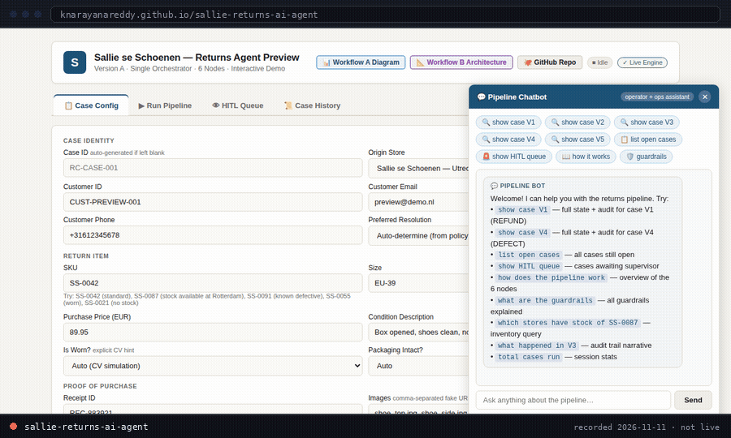</a><sub><a href="https://knarayanareddy.github.io/sallie-returns-ai-agent/"><b>sallie-returns-ai-agent</b></a> — returns pipeline · recorded 2026-11-07 · plays inline</sub>

<a href="https://knarayanareddy.github.io/toolscour/">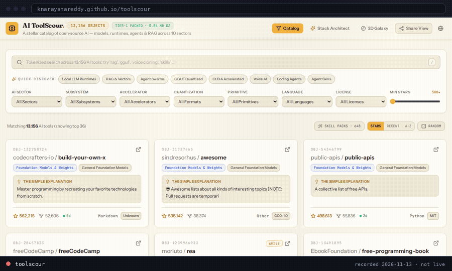</a><sub><a href="https://knarayanareddy.github.io/toolscour/"><b>toolscour</b></a> — 3D knowledge galaxy · recorded 2026-11-07 · plays inline</sub>

<details><summary><b>▶ 18 more recordings</b> <sub>(click a cover to play it in the reel player)</sub></summary>
<table width="100%">
<tr><td width="25%" align="center" valign="top">
<a href="https://knarayanareddy.github.io/knarayanareddy/reel.html?r=3dexperimentation">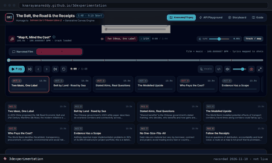</a>
<sub><a href="https://knarayanareddy.github.io/knarayanareddy/reel.html?r=3dexperimentation"><b>3dexperimentation</b></a> ▶</sub>
</td><td width="25%" align="center" valign="top">
<a href="https://knarayanareddy.github.io/knarayanareddy/reel.html?r=Aeroscribe">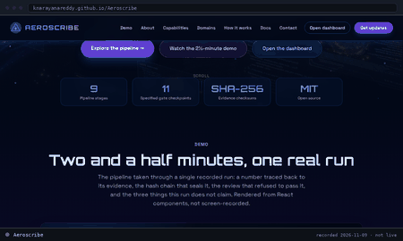</a>
<sub><a href="https://knarayanareddy.github.io/knarayanareddy/reel.html?r=Aeroscribe"><b>Aeroscribe</b></a> ▶</sub>
</td><td width="25%" align="center" valign="top">
<a href="https://knarayanareddy.github.io/knarayanareddy/reel.html?r=AI-Arsenal">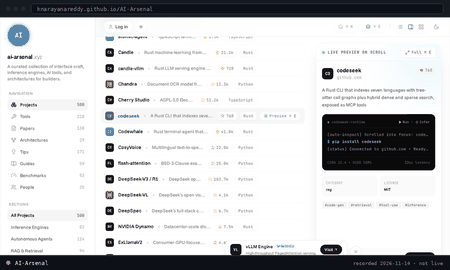</a>
<sub><a href="https://knarayanareddy.github.io/knarayanareddy/reel.html?r=AI-Arsenal"><b>AI-Arsenal</b></a> ▶</sub>
</td><td width="25%" align="center" valign="top">
<a href="https://knarayanareddy.github.io/knarayanareddy/reel.html?r=AI-Daily">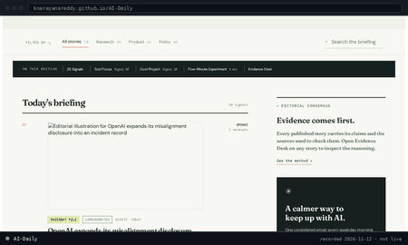</a>
<sub><a href="https://knarayanareddy.github.io/knarayanareddy/reel.html?r=AI-Daily"><b>AI-Daily</b></a> ▶</sub>
</td></tr><tr><td width="25%" align="center" valign="top">
<a href="https://knarayanareddy.github.io/knarayanareddy/reel.html?r=Bunqsy">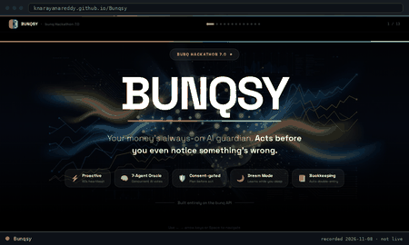</a>
<sub><a href="https://knarayanareddy.github.io/knarayanareddy/reel.html?r=Bunqsy"><b>Bunqsy</b></a> ▶</sub>
</td><td width="25%" align="center" valign="top">
<a href="https://knarayanareddy.github.io/knarayanareddy/reel.html?r=curiolab">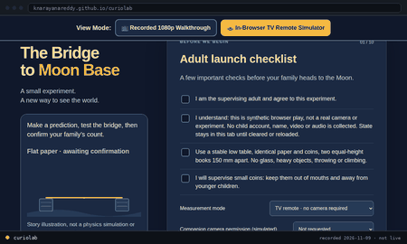</a>
<sub><a href="https://knarayanareddy.github.io/knarayanareddy/reel.html?r=curiolab"><b>curiolab</b></a> ▶</sub>
</td><td width="25%" align="center" valign="top">
<a href="https://knarayanareddy.github.io/knarayanareddy/reel.html?r=dreamswarm">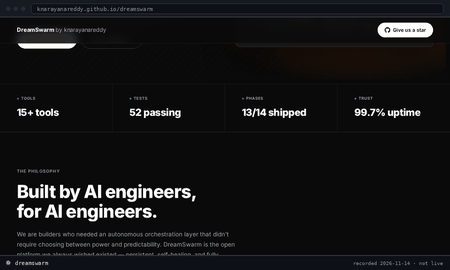</a>
<sub><a href="https://knarayanareddy.github.io/knarayanareddy/reel.html?r=dreamswarm"><b>dreamswarm</b></a> ▶</sub>
</td><td width="25%" align="center" valign="top">
<a href="https://knarayanareddy.github.io/knarayanareddy/reel.html?r=gitscour">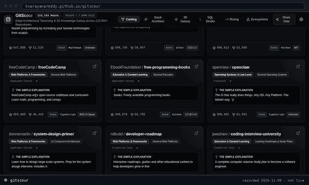</a>
<sub><a href="https://knarayanareddy.github.io/knarayanareddy/reel.html?r=gitscour"><b>gitscour</b></a> ▶</sub>
</td></tr><tr><td width="25%" align="center" valign="top">
<a href="https://knarayanareddy.github.io/knarayanareddy/reel.html?r=gridqueue-grid-connection">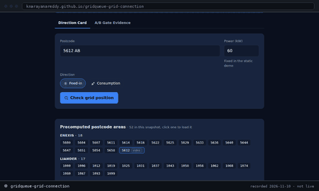</a>
<sub><a href="https://knarayanareddy.github.io/knarayanareddy/reel.html?r=gridqueue-grid-connection"><b>gridqueue-grid-connection</b></a> ▶</sub>
</td><td width="25%" align="center" valign="top">
<a href="https://knarayanareddy.github.io/knarayanareddy/reel.html?r=harvestgrid">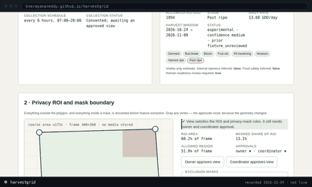</a>
<sub><a href="https://knarayanareddy.github.io/knarayanareddy/reel.html?r=harvestgrid"><b>harvestgrid</b></a> ▶</sub>
</td><td width="25%" align="center" valign="top">
<a href="https://knarayanareddy.github.io/knarayanareddy/reel.html?r=jointcheck-solder-inspection">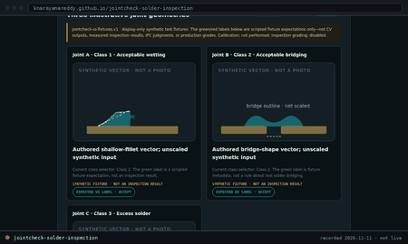</a>
<sub><a href="https://knarayanareddy.github.io/knarayanareddy/reel.html?r=jointcheck-solder-inspection"><b>jointcheck-solder-inspection</b></a> ▶</sub>
</td><td width="25%" align="center" valign="top">
<a href="https://knarayanareddy.github.io/knarayanareddy/reel.html?r=Magpie">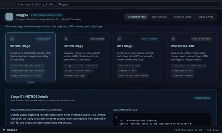</a>
<sub><a href="https://knarayanareddy.github.io/knarayanareddy/reel.html?r=Magpie"><b>Magpie</b></a> ▶</sub>
</td></tr><tr><td width="25%" align="center" valign="top">
<a href="https://knarayanareddy.github.io/knarayanareddy/reel.html?r=Nimbus">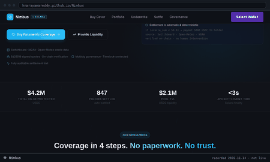</a>
<sub><a href="https://knarayanareddy.github.io/knarayanareddy/reel.html?r=Nimbus"><b>Nimbus</b></a> ▶</sub>
</td><td width="25%" align="center" valign="top">
<a href="https://knarayanareddy.github.io/knarayanareddy/reel.html?r=proofpress-evidence-portal">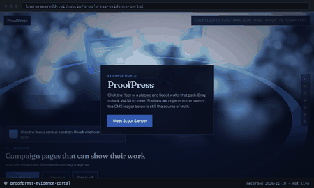</a>
<sub><a href="https://knarayanareddy.github.io/knarayanareddy/reel.html?r=proofpress-evidence-portal"><b>proofpress-evidence-portal</b></a> ▶</sub>
</td><td width="25%" align="center" valign="top">
<a href="https://knarayanareddy.github.io/knarayanareddy/reel.html?r=redflag-eu-compliance">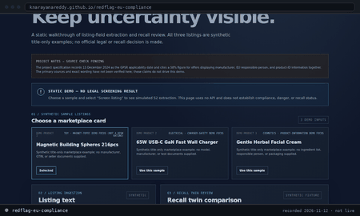</a>
<sub><a href="https://knarayanareddy.github.io/knarayanareddy/reel.html?r=redflag-eu-compliance"><b>redflag-eu-compliance</b></a> ▶</sub>
</td><td width="25%" align="center" valign="top">
<a href="https://knarayanareddy.github.io/knarayanareddy/reel.html?r=roomsmith">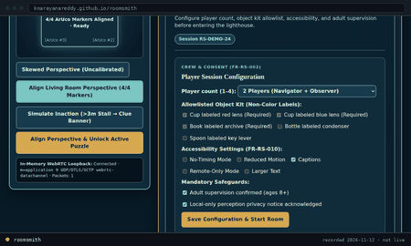</a>
<sub><a href="https://knarayanareddy.github.io/knarayanareddy/reel.html?r=roomsmith"><b>roomsmith</b></a> ▶</sub>
</td></tr><tr><td width="25%" align="center" valign="top">
<a href="https://knarayanareddy.github.io/knarayanareddy/reel.html?r=twitch-codex">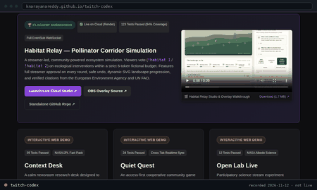</a>
<sub><a href="https://knarayanareddy.github.io/knarayanareddy/reel.html?r=twitch-codex"><b>twitch-codex</b></a> ▶</sub>
</td><td width="25%" align="center" valign="top">
<a href="https://knarayanareddy.github.io/knarayanareddy/reel.html?r=WebsitedesignandPrompts">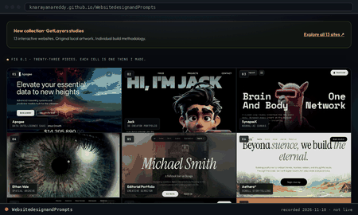</a>
<sub><a href="https://knarayanareddy.github.io/knarayanareddy/reel.html?r=WebsitedesignandPrompts"><b>WebsitedesignandPrompts</b></a> ▶</sub>
</td></tr>
</table>
</details>

<sub><b>Why the grid opens a player instead of playing here:</b> GitHub strips JavaScript from a README and strips <code>loading=lazy</code> from README images, so every image downloads and nothing can be started by a click. Playing all 20 inline would cost every visitor ~44 MB; this section costs ~439 kB of covers plus the two inline recordings. <a href="https://knarayanareddy.github.io/knarayanareddy/reel.html">Open the player</a> to browse all of them with hover previews. Each is captioned with its own date — none is a live feed.</sub>
<!-- REELS:END -->

### 📸 Every deployment, as it actually looks

<picture>
  <source media="(prefers-color-scheme: dark)" srcset="./assets/mosaic-dark.png" />
  <source media="(prefers-color-scheme: light)" srcset="./assets/mosaic-light.png" />
  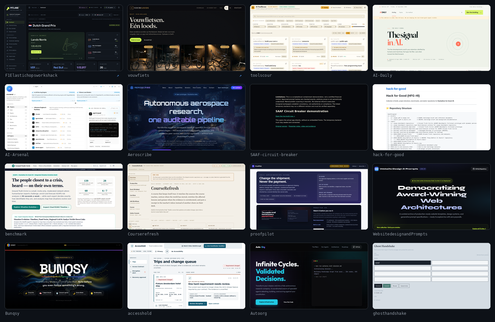
</picture>

<details>
<summary><b>📸 More of the wall (pages 2–3 — all 33 reachable deployments)</b></summary>
<br/>

<picture>
  <source media="(prefers-color-scheme: dark)" srcset="./assets/mosaic-dark-2.png" />
  <source media="(prefers-color-scheme: light)" srcset="./assets/mosaic-light-2.png" />
  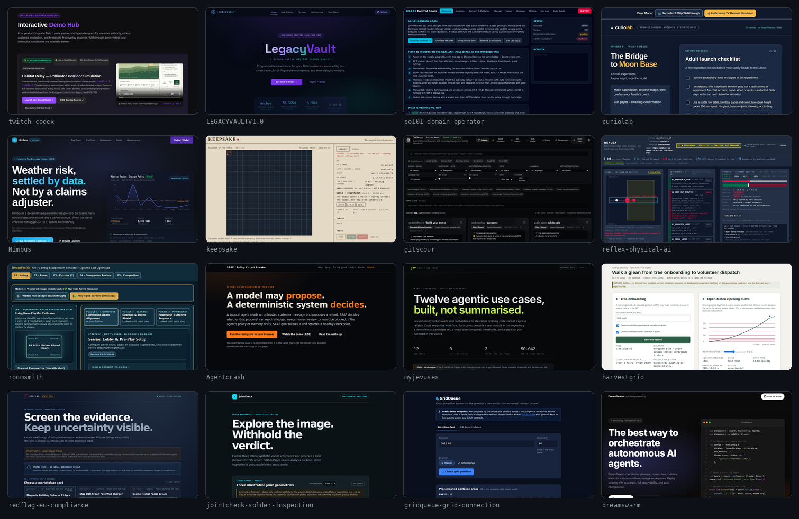
</picture>

<picture>
  <source media="(prefers-color-scheme: dark)" srcset="./assets/mosaic-dark-3.png" />
  <source media="(prefers-color-scheme: light)" srcset="./assets/mosaic-light-3.png" />
  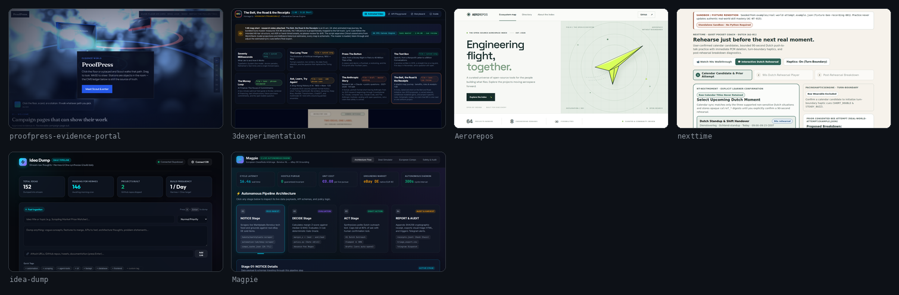
</picture>

</details>

<sub>Real captures taken headlessly by <a href=".github/workflows/screenshots.yml">screenshots.yml</a>, recaptured only when a site changes. Unreachable deployments are detected and left off the wall rather than shown broken — coverage is in <a href="./data/shots-manifest.json">data/shots-manifest.json</a>. <a href="./assets/mosaic-dark.svg">Clickable index</a>.</sub>

<br/>

<details>
<summary><b>📚 The rest of the live catalogue — every deployed site</b></summary>
<br/>

<!-- SITE_CATALOGUE:START -->
<table>
<tr>
<td width="50%" valign="top">

| Live site | Stack |
|-----------|-------|
| [**hack-for-good**](https://knarayanareddy.github.io/hack-for-good/) | `TypeScript` |
| [**benchmark**](https://knarayanareddy.github.io/benchmark/) | `TypeScript` |
| [**Courserefresh**](https://knarayanareddy.github.io/Courserefresh/) | `TypeScript` |
| [**proofpilot**](https://knarayanareddy.github.io/proofpilot/) | `Python` |
| [**accesshold**](https://knarayanareddy.github.io/accesshold/) | `TypeScript` |
| [**Autoorg**](https://knarayanareddy.github.io/Autoorg/) | `TypeScript` |
| [**Handy**](https://knarayanareddy.github.io/Handy/) | `TypeScript` |
| [**ghosthandshake**](https://knarayanareddy.github.io/ghosthandshake/) | `HTML` |
| [**twitch-codex**](https://knarayanareddy.github.io/twitch-codex/) | `JavaScript` |
| [**LEGACYVAULTV1.0**](https://knarayanareddy.github.io/LEGACYVAULTV1.0/) | `TypeScript` |
| [**so101-domain-operator**](https://knarayanareddy.github.io/so101-domain-operator/) | `TypeScript` |
| [**curiolab**](https://knarayanareddy.github.io/curiolab/) | `TypeScript` |
| [**Nimbus**](https://knarayanareddy.github.io/Nimbus/) | `TypeScript` |
| [**keepsake**](https://knarayanareddy.github.io/keepsake/) | `HTML` |
| [**reflex-physical-ai**](https://knarayanareddy.github.io/reflex-physical-ai/) | `Python` |
| [**roomsmith**](https://knarayanareddy.github.io/roomsmith/) | `TypeScript` |

</td>
<td width="50%" valign="top">

| Live site | Stack |
|-----------|-------|
| [**Agentcrash**](https://knarayanareddy.github.io/Agentcrash/) | `TypeScript` |
| [**myjevuses**](https://knarayanareddy.github.io/myjevuses/) | `TypeScript` |
| [**harvestgrid**](https://knarayanareddy.github.io/harvestgrid/) | `Python` |
| [**redflag-eu-compliance**](https://knarayanareddy.github.io/redflag-eu-compliance/) | `Python` |
| [**jointcheck-solder-inspection**](https://knarayanareddy.github.io/jointcheck-solder-inspection/) | `Python` |
| [**SAAF-circuit-breaker**](https://knarayanareddy.github.io/SAAF-circuit-breaker/) | `HTML` |
| [**gridqueue-grid-connection**](https://knarayanareddy.github.io/gridqueue-grid-connection/) | `Python` |
| [**dreamswarm**](https://knarayanareddy.github.io/dreamswarm/) | `Rust` |
| [**proofpress-evidence-portal**](https://knarayanareddy.github.io/proofpress-evidence-portal/) | `HTML` |
| [**3dexperimentation**](https://knarayanareddy.github.io/3dexperimentation/) | `TypeScript` |
| [**nexttime**](https://knarayanareddy.github.io/nexttime/) | `Python` |
| [**idea-dump**](https://knarayanareddy.github.io/idea-dump/) | `Python` |
| [**Magpie**](https://knarayanareddy.github.io/Magpie/) | `Python` |
| [**F1Elastichopsworkshack**](https://f1hackdemo.kiranreddy.nl/) ↗ | `JavaScript` |
| [**vouwfiets**](https://vouwfiets.vercel.app/) ↗ | `JavaScript` |

</td>
</tr>
</table>
<!-- SITE_CATALOGUE:END -->

</details>

---

<!-- RECENT WORK -->
<div align="center">

## 🚀 Recently Shipped

</div>

<!-- SHIPPED:START -->
- 🚀 **[`hack-for-good`](https://github.com/knarayanareddy/hack-for-good)** — [live](https://knarayanareddy.github.io/hack-for-good/) · pushed 2026-11-08
- 🛰️ **[`benchmark`](https://github.com/knarayanareddy/benchmark)** — [live](https://knarayanareddy.github.io/benchmark/) · pushed 2026-11-08
- 🧠 **[`toolscour`](https://github.com/knarayanareddy/toolscour)** — [live](https://knarayanareddy.github.io/toolscour/) · pushed 2026-11-07
- 🧪 **[`AI-Daily`](https://github.com/knarayanareddy/AI-Daily)** — [live](https://knarayanareddy.github.io/AI-Daily/) · pushed 2026-11-07
- 🔭 **[`AI-Arsenal`](https://github.com/knarayanareddy/AI-Arsenal)** — [live](https://knarayanareddy.github.io/AI-Arsenal/) · pushed 2026-11-07
- ⚙️ **[`Aeroscribe`](https://github.com/knarayanareddy/Aeroscribe)** — [live](https://knarayanareddy.github.io/Aeroscribe/) · pushed 2026-11-06
- 🛡️ **[`Courserefresh`](https://github.com/knarayanareddy/Courserefresh)** — [live](https://knarayanareddy.github.io/Courserefresh/) · pushed 2026-11-05
- 🎛️ **[`proofpilot`](https://github.com/knarayanareddy/proofpilot)** — [live](https://knarayanareddy.github.io/proofpilot/) · pushed 2026-11-04
<!-- SHIPPED:END -->

---

## Case Studies

<div align="center">

<sub>Three builds, and what each one actually produced.</sub>

</div>

<table>
<tr>
<td width="33%" valign="top">

<a href="https://knarayanareddy.github.io/Aeroscribe/"><picture><source media="(prefers-color-scheme: dark)" srcset="./assets/tiles/Aeroscribe-dark.svg"><source media="(prefers-color-scheme: light)" srcset="./assets/tiles/Aeroscribe-light.svg"></picture></a>

### 🚀 Aeroscribe
**A manuscript, produced by a pipeline that can't be talked into a claim**

Nine gated stages run literature archaeology → hypothesis → CFD → writing. Each stage writes to an append-only, hash-chained evidence registry, and the writing stage is checked against it — so a sentence with no recorded computation behind it is a blocked build, not a footnote.

The CFD stage calls SU2 with a grid-convergence check. **Without a real SU2 binary it runs a labelled synthetic benchmark and refuses to release the manuscript.** That refusal is the feature: the pipeline produced a submission-ready manuscript for the cases it could verify, and would rather block than guess.

`nine stages` · `hash-chained evidence` · `SU2 + grid convergence` · `offline verifier`

[**live app**](https://knarayanareddy.github.io/Aeroscribe/) · [**source**](https://github.com/knarayanareddy/Aeroscribe)

</td>
<td width="33%" valign="top">

### 🛡️ SAAF Circuit Breaker
**A refunds agent that talks itself out of policy — and the breaker that catches it**

Built at Agents Gone Rogue (SAAF × Just Eat Takeaway × TAG, Amsterdam). The agent is scored on CSAT, writes itself lessons, and rewrites its own instructions every four tickets — so by ticket 36 the genesis policy is no longer in the prompt at all. Priya asks for €21.35 against a €20 cap with no photo and a 1-star threat.

The breaker is four stages — forge, rehearse, sentinel, verify — running against a **real support workflow: a 36-ticket rehearsal over 16 personas, then the live Sentinel calling the real TypeSafe Jev API.** Hard rules live outside the model, so a Jev `ALLOW` still can't override the refund guard. Drift ≥ 0.50 or one weakened hard rule restores the last healthy checkpoint, prompt and memory, and quarantines the rewrite.

**With the watchdog off the agent leaks money. With it on, it pays €0.00 against policy.** The workpaper is then re-verified offline with zero model calls: alter a verdict without rehashing and verification fails.

`36-ticket rehearsal` · `live Jev API` · `rollback` · `offline hash verify`

[**source**](https://github.com/knarayanareddy/SAAF-circuit-breaker)

</td>
<td width="33%" valign="top">

<a href="https://knarayanareddy.github.io/Bunqsy/"><picture><source media="(prefers-color-scheme: dark)" srcset="./assets/tiles/Bunqsy-dark.svg"><source media="(prefers-color-scheme: light)" srcset="./assets/tiles/Bunqsy-light.svg"></picture></a>

### 🏆 Bunqsy
**Placed at bunq Hackathon 7.0** — an always-on financial guardian

BUNQSY doesn't wait for a prompt. A 30-second heartbeat syncs every account, computes a 0–100 health score from balance, velocity, goals and upcoming obligations, and puts seven concurrent risk sub-agents to a vote. Cross the threshold and it **acts**: voice narration, plan-gated card freezes, drafts cancelled — every action routed through PLAN → CONFIRM → EXECUTE.

At night, Dream Mode analyses patterns in an isolated worker and returns a DNA card plus three suggestions. Built on the real bunq REST API with RSA-2048 request signing.

`7-agent oracle` · `PLAN→CONFIRM→EXECUTE` · `Dream Mode` · `ElevenLabs voice`

[**live demo**](https://knarayanareddy.github.io/Bunqsy/) · [**source**](https://github.com/knarayanareddy/Bunqsy)

</td>
</tr>
</table>

---

## What I'm Building

<div align="center">

| | Track | The idea | Flagships |
|:--:|-------|----------|-----------|
| 🛰️ | **Agent harnesses** | Frontier models are only as good as the cage around them: confinement rings, isolation, durable state, review loops | [**apex**](https://github.com/knarayanareddy/apex) · [**Harness-Zero**](https://github.com/knarayanareddy/Harness-Zero) · [**Autoorg**](https://knarayanareddy.github.io/Autoorg/) |
| 🚀 | **Aerospace research** | An autonomous research lab where every quantitative claim traces back to a recorded computation | [**Aeroscribe**](https://knarayanareddy.github.io/Aeroscribe/) · [**Aerorepos**](https://knarayanareddy.github.io/Aerorepos/) |
| 🛡️ | **Compliance-as-code** | Regulation as an executable gate, not a PDF: EU AI Act, GPSR, DSA evidence packs | [**exhibit**](https://github.com/knarayanareddy/exhibit) · [**redflag-eu-compliance**](https://github.com/knarayanareddy/redflag-eu-compliance) · [**listguard**](https://github.com/knarayanareddy/listguard) · [**clausewindow**](https://github.com/knarayanareddy/clausewindow) |
| 🦾 | **Physical AI** | Safety envelopes, verification ledgers and domain-scoped operators for robots that touch the real world | [**reflex-physical-ai**](https://github.com/knarayanareddy/reflex-physical-ai) · [**so101-domain-operator**](https://knarayanareddy.github.io/so101-domain-operator/) · [**jointcheck**](https://github.com/knarayanareddy/jointcheck-solder-inspection) |
| 💸 | **Agentic finance** | Agents that act before damage is done, with a gate between proposal and execution | [**Bunqsy**](https://knarayanareddy.github.io/Bunqsy/) · [**Guardian**](https://github.com/knarayanareddy/Guardian) · [**LEGACYVAULTV1.0**](https://knarayanareddy.github.io/LEGACYVAULTV1.0/) |
| ♿ | **Accessibility** | Interfaces that adapt to the person instead of asking the person to adapt | [**clarion**](https://github.com/knarayanareddy/clarion) · [**accesshold**](https://knarayanareddy.github.io/accesshold/) · [**LitPlay**](https://github.com/knarayanareddy/LitPlay) |

</div>

---

## Hackathons & Sprints

<div align="center">

> Built under a clock, shipped to a live demo, documented afterwards.

| Event | What shipped |
|-------|--------------|
| bunq Hackathon 7.0 | [**BUNQSY**](https://knarayanareddy.github.io/Bunqsy/) — always-on financial guardian with a 7-agent risk oracle |
| Vultr Cloud Hackathon | [**SENTINEL**](https://github.com/knarayanareddy/Sentinel) — fail-closed financial oversight agent behind a 3-signal gate |
| Slack Agent Builder Challenge | [**Clarion**](https://github.com/knarayanareddy/clarion) — accessibility agent, live-tested in a real Slack sandbox |
| Prosus Build Weekend | [**Magpie**](https://github.com/knarayanareddy/Magpie) — autonomous classifieds scout that haggles and closes |
| TechEx Amsterdam | [**Agentcrash**](https://knarayanareddy.github.io/Agentcrash/) — SAAF policy circuit breaker for support agents |
| TwitchCon Codex Hackathon | [**twitch-codex**](https://github.com/knarayanareddy/twitch-codex) — four live-audience, control and accessibility builds |
| OneGov / Alkemio | [**onegov2-spatial-assistant**](https://github.com/knarayanareddy/onegov2-spatial-assistant) — Dutch spatial-assistant challenge entry |
| F1 × Elastic × Hopsworks | [**F1Elastichopsworkshack**](https://f1hackdemo.kiranreddy.nl/) — explorable 2023–24 race workspace |

</div>

---

## Collections & Explorers

<div align="center">

### The scout family — four indexes, one idea

<sub>Take something too large to browse, shard it until it fits in a static file, and give it an interface you can actually think in.</sub>

</div>

<table>
<tr>
<td width="50%" valign="top">

<a href="https://knarayanareddy.github.io/toolscour/"><picture><source media="(prefers-color-scheme: dark)" srcset="./assets/tiles/toolscour-dark.svg"><source media="(prefers-color-scheme: light)" srcset="./assets/tiles/toolscour-light.svg"></picture></a>

**🛰️ [toolscour](https://knarayanareddy.github.io/toolscour/)** — 12,771 AI tools, models, runtimes and skill packs across 10 domain sectors, sharded into a < 1.8 MB gzip tier-1 index with **sub-5 ms tokenized search**. The 3D knowledge galaxy is a hand-rolled 60 FPS canvas projection — no Three.js — and the stack architect scores a proposed pipeline for hardware, primitive and licence compatibility.

`JavaScript` · `sharded index` · `60 FPS canvas` · `$0 hosting`

</td>
<td width="50%" valign="top">

<a href="https://knarayanareddy.github.io/gitscour/"><picture><source media="(prefers-color-scheme: dark)" srcset="./assets/tiles/gitscour-dark.svg"><source media="(prefers-color-scheme: light)" srcset="./assets/tiles/gitscour-light.svg"></picture></a>

**🔭 [gitscour](https://knarayanareddy.github.io/gitscour/)** — 50,000+ repositories above 500 stars, classified on four orthogonal axes and queried in-browser through a **WebAssembly SQL console**. Read-only is enforced by validating every `;`-separated statement, because a prefix-only check once let `SELECT 1; DROP TABLE repos` through. Search medians are **gate-asserted in CI** — the build fails above 50 ms.

`Python` · `WASM SQL` · `CI-asserted latency` · `weekly refresh PR`

</td>
</tr>
<tr>
<td width="50%" valign="top">

<a href="https://knarayanareddy.github.io/AI-Arsenal/"><picture><source media="(prefers-color-scheme: dark)" srcset="./assets/tiles/AI-Arsenal-dark.svg"><source media="(prefers-color-scheme: light)" srcset="./assets/tiles/AI-Arsenal-light.svg"></picture></a>

**🧰 [AI-Arsenal](https://knarayanareddy.github.io/AI-Arsenal/)** — a 1,598-file encyclopedia where **every entry is Markdown with schema-validated YAML frontmatter**, so the same repo is a browsable knowledge base for a human and a queryable data API for an agent. Structure first, UI later.

`JavaScript` · `schema-validated` · `1,598 entries` · `agent-consumable`

</td>
<td width="50%" valign="top">

<a href="https://knarayanareddy.github.io/WebsitedesignandPrompts/"><picture><source media="(prefers-color-scheme: dark)" srcset="./assets/tiles/WebsitedesignandPrompts-dark.svg"><source media="(prefers-color-scheme: light)" srcset="./assets/tiles/WebsitedesignandPrompts-light.svg"></picture></a>

**🎨 [WebsitedesignandPrompts](https://knarayanareddy.github.io/WebsitedesignandPrompts/)** — the paywalled web, rebuilt in public: **38 live templates**, each shipped with the full prompt that builds it, a build log and an adaptation guide. Cinematic scroll stories, 3D WebGL camera flights, glassmorphic product pages — engineering as reproducible craft rather than inspiration screenshots.

`HTML` · `38 templates` · `prompt + build log` · `own domain`

</td>
</tr>
</table>

<sub>These are <b>live windows</b>: the newest capture inside a frame that animates — a pulsing LIVE pill, a sweeping scanline — because GitHub strips <code>&lt;iframe&gt;</code>. Captured by <a href=".github/workflows/screenshots.yml">screenshots.yml</a> — the same pipeline that builds the wall above, so these can't go stale.</sub>

<br/>

<div align="center">

| | Project | Why it exists |
|:--:|---------|---------------|
| 🛰️ | [**toolscour**](https://knarayanareddy.github.io/toolscour/) | 11,000+ AI tools mapped as a 3D galaxy, with a stack architect that scores compatibility |
| 🔭 | [**gitscour**](https://knarayanareddy.github.io/gitscour/) | The same sharding pipeline applied to 50,000+ high-star repos |
| 🧰 | [**AI-Arsenal**](https://knarayanareddy.github.io/AI-Arsenal/) | A machine-readable encyclopedia an agent can consume as easily as a human |
| 📰 | [**AI-Daily**](https://knarayanareddy.github.io/AI-Daily/) | Scout → Challenge → Agree, so the news you read was argued with first |
| 🎨 | [**WebsitedesignandPrompts**](https://knarayanareddy.github.io/WebsitedesignandPrompts/) | The paywalled web, rebuilt as reusable templates plus the prompts that make them |
| 🧪 | [**3dexperimentation**](https://knarayanareddy.github.io/3dexperimentation/) | Pure-code animated film studio — Canvas, no assets, 60 FPS |

</div>

---

## Tech Stack

<div align="center">

<!-- TECH_STRIP:START -->
<picture>
  <source media="(prefers-color-scheme: dark)" srcset="./assets/badges-dark.svg" />
  <source media="(prefers-color-scheme: light)" srcset="./assets/badges-light.svg" />
  
</picture>
<!-- TECH_STRIP:END -->

<sub>Drawn by <a href="scripts/build_badges.py">build_badges.py</a> — no third-party badge service, so nothing here can break.</sub>

</div>

---

<!-- INTERACTIVE:START -->
<a href="https://knarayanareddy.github.io/knarayanareddy/"><b>▶ Signal dashboard + contribution terrain</b></a> — hover a bar, lift a block, switch theme  ·  <a href="https://knarayanareddy.github.io/knarayanareddy/snake.html">play the contribution snake</a>  ·  <a href="https://knarayanareddy.github.io/knarayanareddy/reel.html">browse the 20 recorded demos</a>
<!-- INTERACTIVE:END -->

## Signal Dashboard

<div align="center">

<picture>
  <source media="(prefers-color-scheme: dark)" srcset="./assets/dashboard-dark.svg" />
  <source media="(prefers-color-scheme: light)" srcset="./assets/dashboard-light.svg" />
  
</picture>

<sub>One self-rendered card, no third-party widgets, drawn by <a href="scripts/build_dashboard.py">build_dashboard.py</a> from the GitHub contributions API — so the numbers are exact. <b>This is an image:</b> GitHub serves README images through its Camo proxy as <code>&lt;img&gt;</code>, which delivers no pointer events, so nothing inside it can react. The hoverable version is <a href="https://knarayanareddy.github.io/knarayanareddy/">here</a>.</sub>

</div>


### 🏔️ A year of contributions, as terrain

<div align="center">

<picture>
  <source media="(prefers-color-scheme: dark)" srcset="./assets/terrain-dark.svg" />
  <source media="(prefers-color-scheme: light)" srcset="./assets/terrain-light.svg" />
  
</picture>

<sub>371 blocks, one per day, height = that day's output. Drawn by <a href="scripts/build_3d_terrain.py">build_3d_terrain.py</a> from the same calendar the dashboard uses. <b>This is an image too</b>, for the same reason — Camo serves it as <code>&lt;img&gt;</code>. Hover any block to lift it and read its exact date in the <a href="https://knarayanareddy.github.io/knarayanareddy/">interactive version</a>.</sub>

</div>

---

<!-- FOOTER -->
<div align="center">

<picture>
  <source media="(prefers-color-scheme: dark)" srcset="./assets/footer-dark.svg" />
  <source media="(prefers-color-scheme: light)" srcset="./assets/footer-light.svg" />
  
</picture>

**[kiranreddy.nl](https://kiranreddy.nl)** · Delft, Netherlands · Autonomous agents · Aerospace & physical AI · Compliance-as-code

<sub>Live sites, counters and cards refresh themselves daily at 04:17 UTC via <a href=".github/workflows/update-profile.yml">GitHub Actions</a> — see <a href="scripts/build_profile.py">scripts/build_profile.py</a></sub>

</div>

<!-- Last updated: 2026-11-02 10:13 UTC -->
